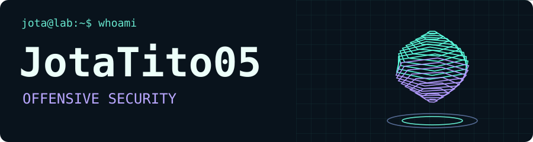

# JotaTito05 · Red Team

Soy profesional de la ciberseguridad ofensiva y me dedico al Red Team. Mi trabajo se centra en simular la actividad de un adversario para evaluar cómo responde una organización.

```console
jota@lab:~$ cat perfil.txt
Certificaciones   CRTA · eJPTv2 · eCPPTv3
En preparación    OSCP
Scripting         Python · Bash · PowerShell
Entornos          Kali Linux · Parrot OS · Windows
```
